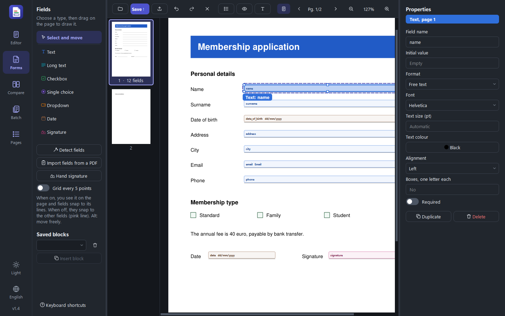
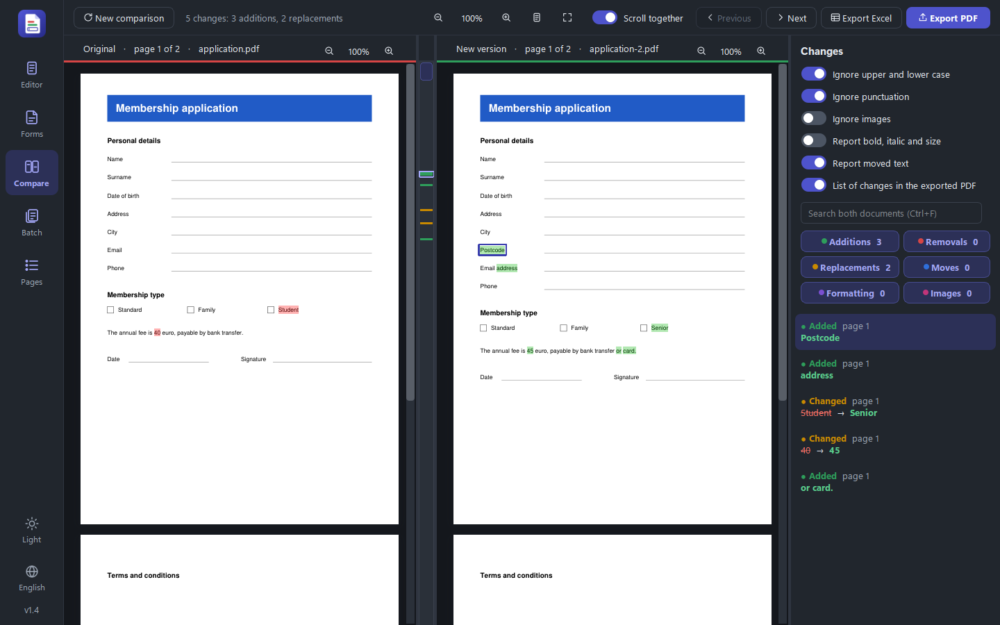
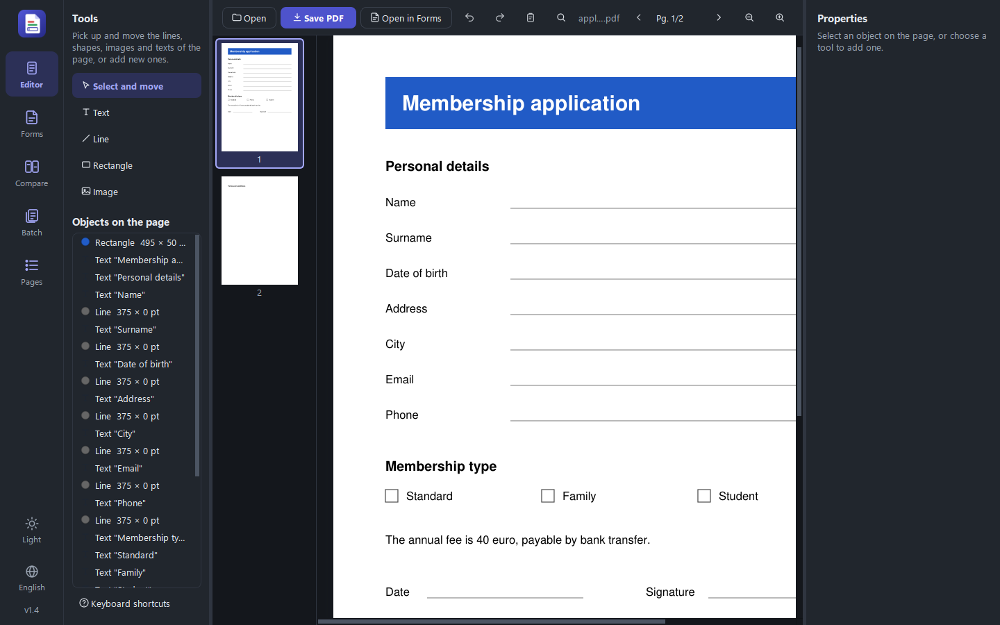

# PDFlex

A Windows app to make fillable PDF forms, compare two versions of a document and fill a form in bulk from Excel. In English and Italian (it follows the Windows language; change it with the globe button).

## What it does

- **Forms**: draw fields (text, date, check boxes, choices, menus, signature) or press *Detect fields* to make them from `____` lines and empty boxes. Also:
  - formats (number, amount in €, $, £ or CHF before or after the number, percentage with the decimals you choose; date and time; postcode, tax code, phone, email), smallest and largest number accepted, totals (sum, average, minimum, maximum, product), font, size, colour and alignment of the text;
  - for every field: width and height in points, tooltip, read-only, visible / hidden / print only / screen only, most characters; check boxes with a check, cross, dot, square, diamond or star; border colour (or none), fill, thickness and style (solid, dashed, beveled, inset, underline);
  - formulas like a spreadsheet's: `ARROTONDA([Quantità] * [Prezzo]; 2)` (SOMMA/SUM, MEDIA/AVERAGE, MIN, MAX, ARROTONDA/ROUND, ASS/ABS, SE/IF; click a field to insert its name), with a number or text as the result; *Show only if* `[Altro] = SÌ E [Importo] > 1000` (E/AND, O/OR, NON/NOT) hides and empties a field while the condition is false. Both work in PDF readers and in PDFlex (Fill in, preview, Batch);
  - *Save form*: the PDF with the fields as you see them, to reopen in PDFlex or to have someone fill in;
  - *Export for software*: a copy with empty fields, no borders and no buttons, for a program that fills them in by itself;
  - select several fields (Ctrl+click) to align them or change their properties all at once ("(mixed)" where they differ), guides while dragging and a 5-point grid;
  - copy and paste fields (a copied table row goes into the next free row, fields stacked in a column into the next free column; elsewhere each paste repeats the move you made), saved blocks of fields to reuse in other forms, fields imported from another PDF;
  - Tab order by drag and drop, by rows or by columns, with its numbers shown on the fields; undo/redo (Ctrl+Z / Ctrl+Y);
  - preview with sample data;
  - *Fill in*: fill the fields by hand, with the filled form beside them, and save a copy.
- **Compare**: shows the differences side by side, scrolling together. You can:
  - ignore upper/lower case and punctuation;
  - filter by kind of change;
  - export to PDF (with the list of changes at the start) or to Excel.

  Scanned documents can be compared only if [Tesseract](https://github.com/UB-Mannheim/tesseract/wiki) is installed.

  
- **Editor**: tidies up the PDF's graphics before making it a form. Pick up and move the page's lines, rectangles, shapes, images and texts, change their size, colours and words, or add text, lines, rectangles and images. Draw a rectangle and a gallery offers ready-made blocks (box with title, table, grid, section, totals) to start from; a block splits into rows and columns, its lines drag, its cells merge and take text, in any of the fonts installed on Windows, at the top, middle or bottom of the cell, and *Sample text* fills the empty cells on screen only. Guides catch edges and middles while moving, drawing and resizing, with the size shown by the mouse. Fields and buttons stay hidden and untouched. A yellow strip warns about what cannot be edited (text drawn as shapes, gradients, clipping), and an edit that would touch anything else is undone. *Save PDF* saves it as a new file (`<name>_modificato.pdf`); *Open in Forms* hands it to Forms to set up the fields.

  
- **Batch**: a PDF form + an Excel/CSV file gives one filled PDF per row (columns go to the fields with the same name, or choose each field's column; formulas and totals are worked out, not read from the file), or a single PDF with all the forms, ready to print.
- **Pages**: merge PDFs, reorder, rotate, delete, extract and split pages. In *Options* you can add page numbers, a header and a watermark and make the file smaller.

Saving shows a short note at the bottom of the window that goes away by itself. If PDFlex closes unexpectedly, the next time it opens it offers to pick up where you left off. A new version is downloaded by itself; it installs when you press the button, and PDFlex reopens.

## Install

Download `PDFlex-Setup-<version>.exe` from [Releases](https://github.com/GabrieleL18/PDFlex/releases) and run it. It installs for your user (no administrator rights), adds PDFlex to the Start menu and to "Open with" for PDF files. Uninstall it from Settings > Apps.

## Build from source

1. `py -m venv .venv` and `.venv\Scripts\pip install -r requirements.txt`
2. `build.bat` makes `dist\PDFlex\PDFlex.exe`; `release.bat <version>` also makes the installer (needs [Inno Setup 6](https://jrsoftware.org/isinfo.php)).

Run from source: `.venv\Scripts\python -m pdflex [file.pdf]`. Tests: `.venv\Scripts\python -m pytest -q`

License: PDFlex uses PyMuPDF (AGPL). Fine for personal/internal use; to distribute or sell it you must publish the source code or buy Artifex's commercial license.
